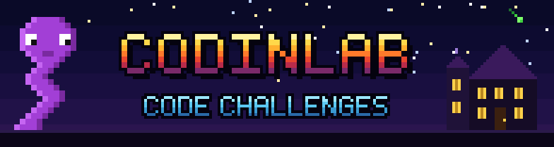

<p align="center">
  
</p>

<p align="center"><b>Write a real program. Watch it play the challenge.</b></p>

---

A modular coding-challenge platform. You write a **real program** (Go for now) and it plays a challenge as an
agent: it **observes** the environment and **acts** on it, while the browser animates every step.

```
web/      React + TypeScript + Vite SPA: catalog, challenges (logic + renderer), editor
runner/   Go service (stdlib only): compiles/runs user code, challenge-agnostic
```

## Run it

```bash
make install   # npm install + go mod download
make dev       # runner (:8787) + web (:5173) together, Ctrl+C stops both
```

Run `make help` for every command (`build`, `test`, `test-e2e`, `check`, `runner`, `web`, `clean`, ...).
`make test-e2e` starts the runner and runs real Go programs that solve all 3 challenges.

## Architecture

**Challenge = Gymnasium-style environment.** The platform only knows this contract
(`web/src/core/challenges/types`):

| Piece | Role |
| --- | --- |
| `environment.reset/observe/step/isCompleted/parseAction` | Pure functions over an immutable state. |
| `Renderer({state})` | The challenge's own visual. |
| `metadata`, `instructions`, `languages[].template` | Catalog data, rules, per-language starter code. |

State lives in an `EnvironmentStore` (`useSyncExternalStore`), one instance per playground mount, so React always
sees changes and challenges never share state.

**Agent protocol.** The user program talks JSON-lines over stdin/stdout through a tiny SDK:
`observe → observation`, `act(action) → step{observation,reward,done,message,error,info}`. The runner forwards each
request to the browser (SSE down, POST up); the browser answers using the challenge's own environment
(`AgentRun`). The runner never sees challenge logic, so each challenge defines its own "API".

**Execution is pluggable on both sides.**
- Web: `ExecutionAdapter` (today `RemoteRunnerAdapter`; a Worker/WASM/other API can replace it in `main.tsx`).
- Runner: `runtime.Runtime` per language and `sandbox.Sandbox` per isolation strategy (`local`, `docker`).

> `--sandbox=local` gives **no isolation**: use it only with your own code. `--sandbox=docker` runs each submission in an
> ephemeral container (no network, CPU/mem/pids limits); it needs a running Docker daemon (untested here).

## Add a challenge

1. Create `web/src/challenges/<id>/` with `environment.ts`, `Renderer.tsx`, `instructions.ts`,
   `templates/<lang>.ts` and `index.ts` calling `defineChallenge(...)` (copy `maze/`).
2. Add it to `challengeRegistry` in `web/src/core/challenges/registry/index.ts`.

No page or core component changes. The explorer, preview and playground discover it automatically.

### Let Claude do it

The repo ships a Claude Code agent, `.claude/agents/challenge-author.md`, that creates the module, tests and
registration and runs `make check` / `make test-e2e` to verify it:

```
/new-challenge Tower of Hanoi, Medium, recursion
```

## Add a language (e.g. Python)

1. Runner: implement `runtime.Runtime` (`ID`, `Prepare` writes the source + an SDK client, returns build/run
   commands) and register it in `runner/cmd/runner/main.go`. Write the SDK client for the same JSON-lines protocol.
2. Web: add `{ id, label, template }` to each challenge's `languages`, and (optionally) a tokenizer in
   `components/CodeEditor/syntax/`.
3. Docker sandbox: add the language's image mapping.
